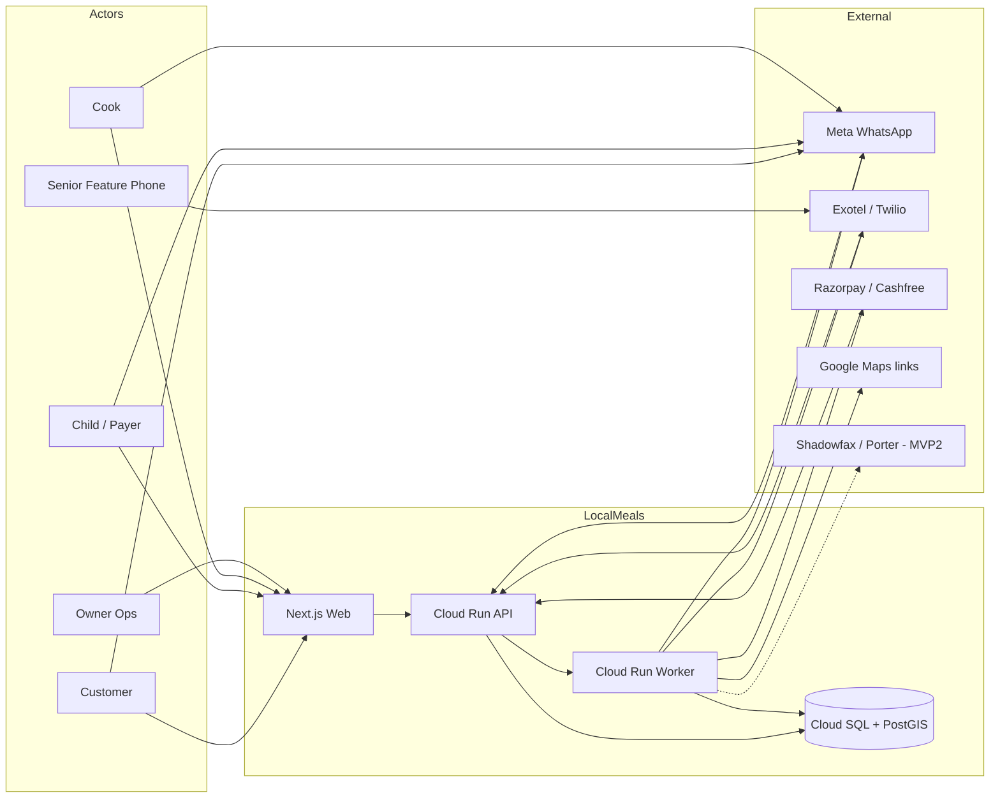
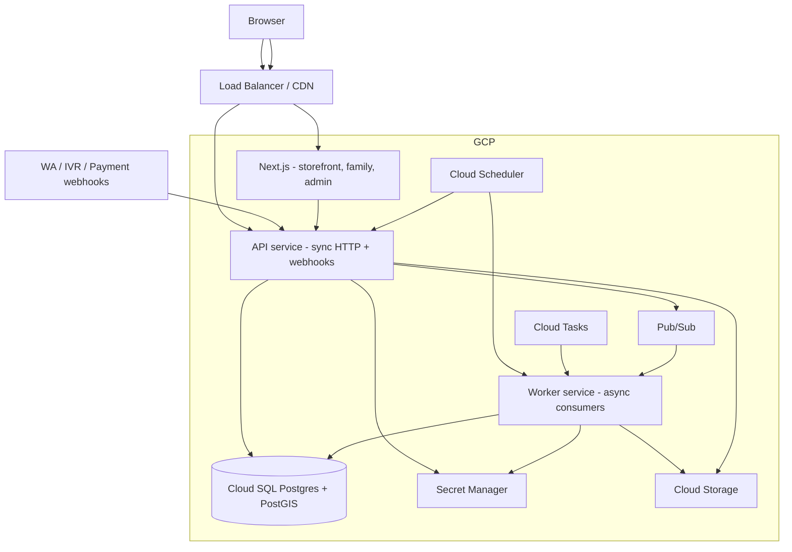
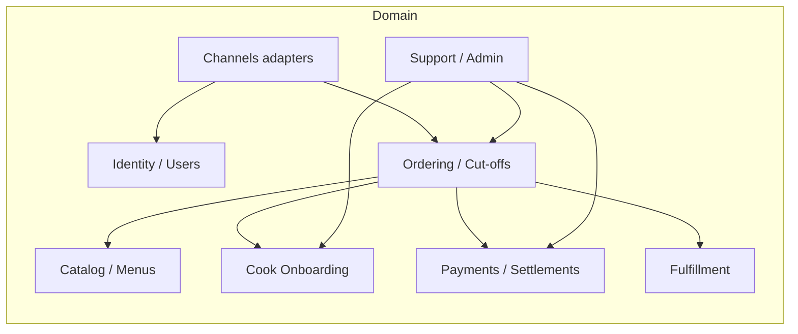
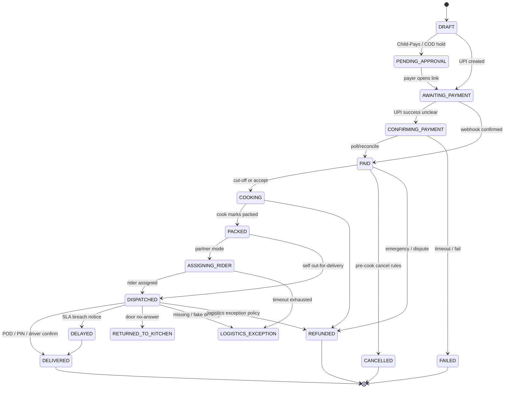
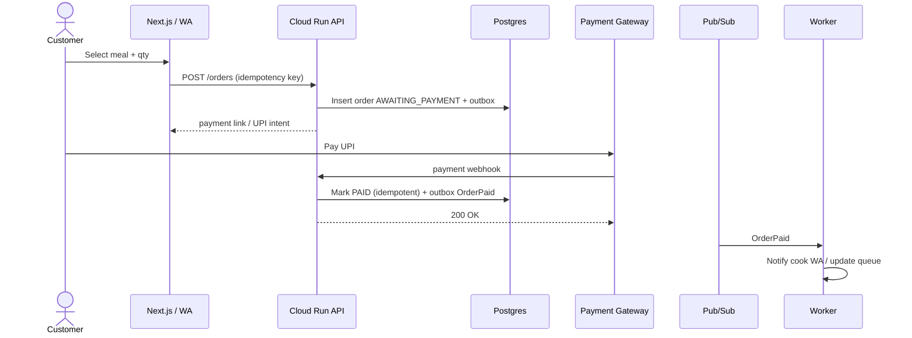
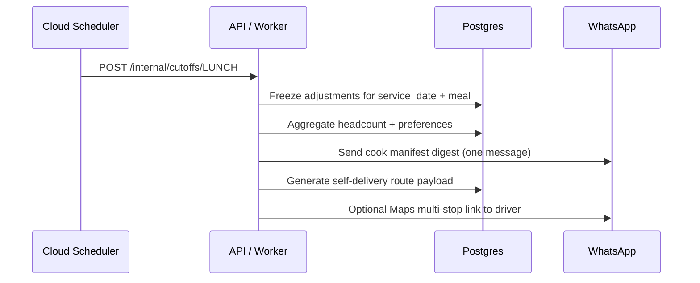
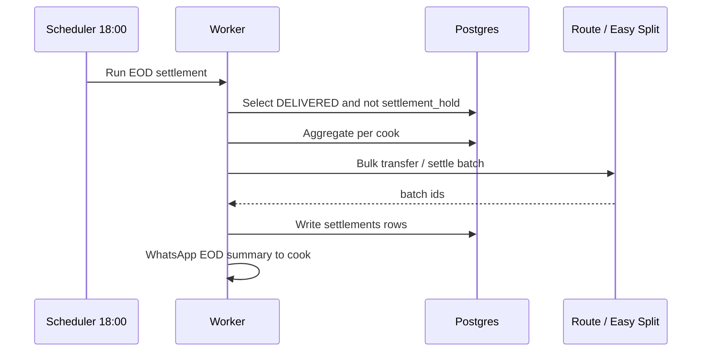
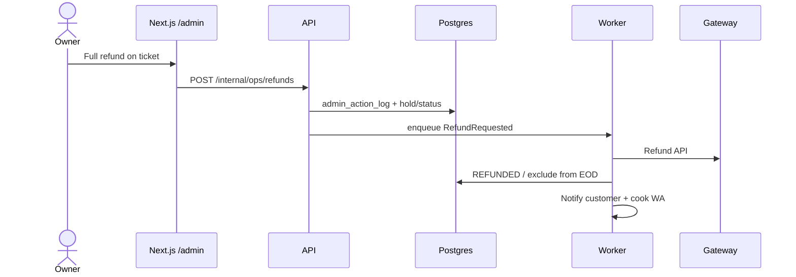
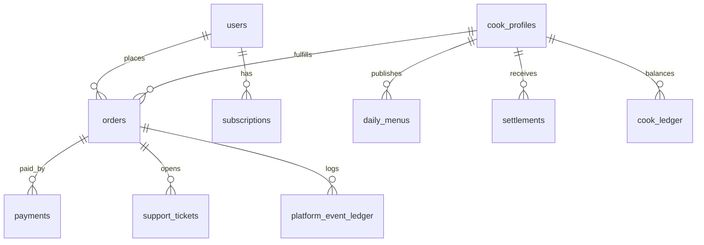

# LocalMeals (HomeFood) — Technical Design Document

**Audience:** Engineers picking up the codebase  
**Status:** Draft for MVP-1 implementation  
**Companion product blueprint:** `~/Downloads/HomeFood.md` (Sections 1–18)  
**UI click-through demo:** this repository (`npm run dev`)

---

## 1. Purpose

LocalMeals is a hyper-local **Zero-UI** food platform for Tamil Nadu home kitchens:

- **Customers** order via web, WhatsApp, or IVR (seniors)
- **Cooks** operate mainly via WhatsApp (+ light web desk)
- **Family (Child Pays)** approves UPI for parents
- **Owner** resolves disputes via `/admin`
- **Delivery partners** (later) use *their* apps; we integrate via API/webhooks

This document describes **architecture, components, data flows, and implementation boundaries** so a developer can implement without re-deriving decisions from the long product blueprint.

---

## 2. Goals and non-goals

### Goals (MVP-1)

| Goal | Meaning |
|------|---------|
| One pin, lunch-only | Density before breadth |
| Modular monolith | One Node/TS API + Worker on Cloud Run |
| Deterministic order state machine | Channels are adapters only |
| Cut-off gates | Protect cook ingredient waste |
| Clean cook payout | EOD bulk settlement via Route/Easy Split |
| Owner ops console | Refunds, holds, tickets (required) |
| SELF delivery first | Maps route link + WhatsApp; no rider app |

### Non-goals (MVP-1)

- Microservices / GKE
- Native mobile apps
- Prepaid family wallet
- Shadowfax/Porter (defer to MVP-2)
- Statewide pantry, steel tiffin, catering RFQ
- Full event sourcing / Kafka

---

## 3. Locked tech stack

| Layer | Choice |
|-------|--------|
| Web | Next.js (React + TypeScript) |
| API / Worker | Node.js TypeScript (NestJS **or** Fastify) modular monolith |
| Runtime | Google Cloud Run (API + Worker, same image) |
| DB | Cloud SQL PostgreSQL + PostGIS |
| Events | Pub/Sub + transactional outbox |
| Cron | Cloud Scheduler (cut-offs, EOD) |
| Delayed jobs | Cloud Tasks (late UPI expiry, retries) |
| Secrets | Secret Manager |
| Files | Cloud Storage |
| Payments | Razorpay Route / Cashfree Easy Split |
| Channels | Meta WhatsApp Cloud API, Exotel/Twilio IVR |
| Observability | Cloud Logging / Monitoring / Error Reporting |

---

## 4. System context



**Rule:** Partners never log into LocalMeals. Riders use partner apps; we create jobs and consume webhooks.

---

## 5. Container view (C4-style)



| Container | Responsibility |
|-----------|----------------|
| **Next.js** | Customer discover/storefront, Child-Pays, cook light desk, `/admin` |
| **API** | Authz, commands/queries, webhook verify + fast ACK, write DB + outbox |
| **Worker** | Notifications, cut-off freeze side-effects, refunds, EOD settlement, partner calls |
| **Postgres** | System of record (orders, money, ledgers, geo) |
| **Pub/Sub** | Fan-out after commit (not source of truth) |

---

## 6. Modular monolith (code boundaries)

Suggested package layout (single repo):

```text
apps/
  web/                 # Next.js
  api/                 # HTTP entry
  worker/              # Pub/Sub + Tasks entry
packages/
  domain/              # order state machine, cut-off rules, money invariants
  db/                  # migrations, repositories
  channels/            # whatsapp, ivr adapters
  payments/            # razorpay/cashfree clients
  fulfillment/         # self route + partner clients (MVP2)
  common/              # logging, idempotency, auth
```

### Modules (domain)



**Invariant:** WhatsApp/IVR/Web controllers translate intents → domain commands. They must not implement cut-off or refund rules inline.

---

## 7. Order state machine



Settlement flag: `orders.settlement_hold = true` excludes the plate from EOD cook payout until admin resolves.

**Post-settlement refund recovery:** if the order already has `settlement_id` when Admin refunds, enqueue `cook_ledger` `CLAWBACK_PENDING` (food net only). Next `runEodSettlement` for that cook FIFO-applies clawbacks up to that day’s food gross → `settlements.clawback_paise`, `net = gross − clawback`. Remainder stays pending.

---

## 8. Core sequence diagrams

### 8.1 Web / WhatsApp place order + pay



### 8.2 Cut-off gate



### 8.3 EOD settlement



### 8.4 Owner refund (admin)



---

## 9. Event-driven edges (hybrid)

Use **transactional outbox**, not “fire Pub/Sub then hope DB committed.”

| Event | Typical consumers |
|-------|-------------------|
| `OrderPaid` | Cook + customer WA per day-line; payload includes `serviceDate`, `mealType`, `checkoutDayCount` / `checkoutDayOrdinal` (week cart = day N of M + `checkoutId`) |
| `CutoffReached` | Manifest WA, route build |
| `DeliverySlaBreached` | Delay WA to customer/payer |
| `KitchenEmergencyCancelled` | Bulk refunds, IVR robocall |
| `SettlementBatchRequested` | Gateway settle |
| `RiderAssignTimedOut` | Porter failover (MVP-2) |
| `SupportTicketOpened` | Admin alerting |

**Sync stays for:** checkout validation, LIVE/capacity checks, webhook signature verify + persist + 200.

---

## 10. Data model (implementation baseline)

Extend blueprint Section 13 + gaps in Sections 15–18.

### Critical tables

| Table | Role |
|-------|------|
| `users` | Mobile PK, segment, language, consents |
| `addresses` | Normalized geo points (not only TEXT) |
| `cook_profiles` | slug, geo, FSSAI, onboarding_status, capacity, delivery_type |
| `daily_menus` | `service_date` and/or day_of_week, allergens, stock |
| `subscriptions` | unique `(user_mobile, cook_id, meal_type)` |
| `orders` | state machine, hold, redirect, channel |
| `payments` | splits, refunds, gateway ids |
| `settlements` | cook EOD batches |
| `cook_ledger` | pending platform fees, COD adjustments |
| `ratings_reviews` | throttle inputs |
| `support_tickets` | disputes / SLAs |
| `admin_action_log` | immutable ops audit |
| `platform_event_ledger` | Zero-UI forensic log |
| `outbox` | reliable pub |

### ER sketch



---

## 11. API sketch (for developers)

### Public / customer

- `GET /kitchens?pin=&near=`
- `GET /kitchens/:slug/menu?date=`
- `POST /orders` — create / reserve
- `POST /orders/:id/cancel` — pre-cut-off rules
- `GET /orders/:id`
- `POST /family/links` — Child-Pays binding

### Webhooks (HMAC verify, idempotent)

- `POST /webhooks/whatsapp`
- `POST /webhooks/exotel` (or Twilio)
- `POST /webhooks/payments`
- `POST /webhooks/shadowfax` (MVP-2)

### Internal (IAM / private)

- `POST /internal/cutoffs/:meal`
- `POST /internal/settlements/eod`
- `POST /internal/ops/refunds`
- `POST /internal/ops/holds`
- `POST /internal/ops/cooks/:id/pause`

All money mutations must be **idempotent** and write `admin_action_log` when triggered by humans.

---

## 12. Channel design

| Channel | UX | Backend |
|---------|----|---------|
| Web | Discover, calendar strip, checkout, family, admin | Same order commands |
| WhatsApp | List messages, buttons, cook digest | Adapter → commands; template catalogue required |
| IVR | Tamil/English TTS + DTMF | Caller ID → profile; Press 1 → order intent |

**Child Pays:** senior creates `PENDING_APPROVAL` / pay link to `payer_mobile`; payer confirms UPI → `PAID`.

---

## 13. Fulfillment

### SELF (MVP-1)

1. Cut-off aggregates drops  
2. Worker builds sequenced Maps URL  
3. WhatsApp to family driver  
4. Status via cook/driver button taps  

### PARTNER (MVP-2)

1. Batch create on Shadowfax API  
2. Webhooks update status  
3. Timeout → Porter failover  
4. Fake delivery → PIN miss → logistics exception + refund policy  

**Do not build a LocalMeals rider app.**

---

## 14. Security and compliance (dev checklist)

See **[SECURITY.md](./SECURITY.md)** for PCI scope (SAQ A assumptions) and live controls.

- [x] Never expose cook personal mobile to customers (API responses use kitchen name / slug)
- [x] Kitchen coordinates only to assigned fulfillment actor (SELF Maps link; no public lat/lng on customer kitchen list beyond what’s needed for distance — revisit if exposing pin only)
- [x] Webhook signature verification on all ingress (Razorpay + Meta when not mock)
- [ ] Secrets only in Secret Manager (documented; enforce in prod deploy)
- [ ] Settlement worker least-privilege IAM  
- [x] FSSAI + gateway KYC before cook `LIVE` (domain gates)
- [x] No custom prepaid wallet in MVP  
- [x] PII retention purge for event ledger / OTP / WA sessions (`POST /internal/ops/retention`; IVR N/A in MVP-1)  
- [x] Kitchen mutators require COOK/ADMIN; confirm-return trusts gateway; OTP hashed + throttled  
- [x] CORS allow-list; Postgres-backed rate limits; upload content sniff; session revoke on logout; CSP nonce  
- [ ] Formal PCI SAQ / pen-test before scale (SAQ A checklist in SECURITY.md)  


---

## 15. Observability

Implemented: structured JSON logs + correlation + Cloud Monitoring log-based alerts — see [OBSERVABILITY.md](./OBSERVABILITY.md).

Alert on (wired when `alert_email` set):

- Webhook signature failures (`webhook.signature_failed`)  
- Payment webhook lag / `CONFIRMING_PAYMENT` stuck (`payment.confirming_stuck`)  
- Cut-off job miss (Scheduler failure + `cutoff.reached` metric)  
- Settlement batch failure (`settlement.batch_failed`)  
- WhatsApp send failures (`whatsapp.send_failed`) / outbox failures (`outbox.failed`)  

Later / not MVP-1:

- `ASSIGNING_RIDER` timeout rate (partner delivery)  
- WhatsApp template quality rating drop (Meta dashboard)  

---

## 16. MVP delivery plan (engineering)

| Phase | Scope |
|-------|-------|
| **MVP-1** | One pin, lunch, web+WA, SELF delivery, cut-offs, UPI, EOD settle, KYC/FSSAI, admin refunds/tickets |
| **MVP-2** | IVR + Child-Pays hardening, partner delivery APIs, ratings throttle |
| **MVP-3** | Pantry shipping, tiffin loop, catering RFQ |

Prototype shortcut (optional): Next.js + managed Postgres for UI/pilot — **move money workers to Cloud Run before scale**.

---

## 17. How a developer should pick this up

1. Read this TDD (architecture + invariants).  
2. Skim `HomeFood.md` Sections **3, 6, 11, 14, 17, 18** for product rules.  
3. Run UI demo in this repo to see journeys.  
4. Implement in order:  
   1. DB migrations + order state machine  
   2. Checkout + payment webhook idempotency  
   3. Cut-off job + cook WA digest  
   4. EOD settlement  
   5. Admin refund/hold  
   6. Channels polish (WA templates, IVR)  
5. Do **not** split microservices until a clear scale/IAM axis appears.

### Definition of done (MVP-1 technical)

- Customer can pay once; double-tap cannot double-charge  
- After cut-off, cook receives **one** manifest  
- EOD produces one clean cook credit (or explicit failure + retry)  
- Owner can refund/hold from `/admin` with audit log  
- Cook cannot go LIVE without FSSAI + payout details (UPI / bank note; Route optional while blocked)  

---

## 18. Open decisions (track explicitly)

| Item | Default until decided |
|------|------------------------|
| NestJS vs Fastify | Either; pick one repo-wide |
| Monorepo tool | pnpm + turborepo (suggested) |
| Auth for customers | Phone OTP |
| Auth for admin | Google Workspace / strong OTP + role |
| Maps routing algo | Simple nearest-neighbor OK for &lt;40 stops at start |

---

## Document history

| Version | Date | Notes |
|---------|------|-------|
| 0.1 | 2026-11-04 | Initial TDD from HomeFood blueprint Sections 1–18 + GCP stack lock |
